## 1. Агрегатные функции: COUNT(), SUM(), AVG(), MIN(), MAX(), STRING_AGG()

### 1.1. COUNT() - Подсчёт общего количества клиентов
Узнать, сколько всего клиентов зарегистрировано в базе данных.
```sql
SELECT COUNT(*) AS total_clients
FROM Clients;
```

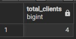

### 1.2. COUNT() - Подсчёт уникальных городов, где живут клиенты
Узнать, в скольких разных городах проживают наши клиенты (без учёта повторов).
```sql
SELECT COUNT(DISTINCT city) AS unique_cities
FROM Clients;
```

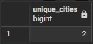

### 1.3. SUM() - Общая вместимость всех залов фитнес-клуба
Посчитать, сколько всего человек могут одновременно заниматься во всех залах.
```sql
SELECT SUM(capacity) AS total_capacity
FROM Gyms;
```

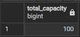

### 1.4. SUM() - Общая длительность всех проведённых тренировок
Узнать суммарное время (в минутах), которое было потрачено на все тренировки в расписании.
```sql
SELECT SUM(wt.duration_min) AS total_duration_minutes
FROM Workouts w
JOIN WorkoutTypes wt ON w.workout_type_id = wt.workout_type_id;
```

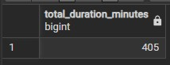

### 1.5. AVG() - Средняя оценка посещений
Вычислить средний рейтинг, который клиенты ставят после тренировок.
```sql
SELECT AVG(rating) AS average_rating
FROM Visits;
```

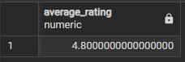

### 1.6. AVG() - Средняя длительность тренировок каждого типа
Узнать среднюю продолжительность тренировок по каждому типу.
```sql
SELECT title, AVG(duration_min) AS avg_duration
FROM WorkoutTypes
GROUP BY title;
```

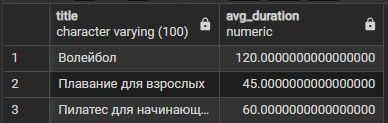

### 1.7. MIN() - Минимальная оценка среди всех посещений
Найти наименьшую оценку, которую поставил хотя бы один клиент.
```sql
SELECT MIN(rating) AS min_rating
FROM Visits;
```

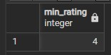

### 1.8. MIN() - Зал с наименьшей вместимостью
Узнать, какой зал имеет самую маленькую вместимость.
```sql
SELECT name, MIN(capacity) AS min_capacity
FROM Gyms
GROUP BY name;
```

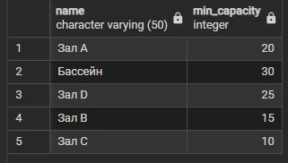

### 1.9. MAX() - Максимальная оценка среди всех посещений
Найти наивысшую оценку, которую ставили клиенты.
```sql
SELECT MAX(rating) AS max_rating
FROM Visits;
```


### 1.10. MAX() - Зал с наибольшей вместимостью
Узнать, какой зал может принять больше всего человек одновременно.
```sql
SELECT name, capacity
FROM Gyms
WHERE capacity = (SELECT MAX(capacity) FROM Gyms);
```

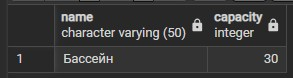

### 1.11. STRING_AGG() - Список всех клиентов через запятую
Получить одну строку, где перечислены все клиенты фитнес-клуба через запятую.
```sql
SELECT STRING_AGG(first_name || ' ' || last_name, ', ') AS clients_list
FROM Clients;
```


### 1.12. STRING_AGG() - Список всех специализаций тренеров с сортировкой
Получить отсортированный по алфавиту список всех специализаций, которые есть у тренеров клуба.
```sql
SELECT STRING_AGG(s.name, ', ' ORDER BY s.name) AS specializations_list
FROM Specializations s;
```


## 2. GROUP BY и HAVING

### 2.1. GROUP BY - Количество клиентов в каждом городе
Узнать, сколько клиентов проживает в каждом городе.
```sql
SELECT city, COUNT(*) AS client_count
FROM Clients
GROUP BY city;
```

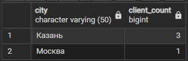

### 2.2. GROUP BY - Количество тренировок каждого типа
Узнать, сколько раз проводилась каждая тренировка.
```sql
SELECT wt.title, COUNT(w.workout_id) AS workout_count
FROM WorkoutTypes wt
JOIN Workouts w ON wt.workout_type_id = w.workout_type_id
GROUP BY wt.title;
```

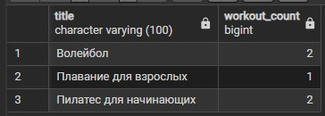

### 2.3. HAVING - Города, где проживает более 1 клиента
Найти города, в которых живет больше одного клиента.
```sql
SELECT city, COUNT(*) AS client_count
FROM Clients
GROUP BY city
HAVING COUNT(*) > 1;
```

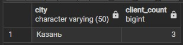

### 2.4. HAVING - Типы тренировок, проводившиеся более 1 раза
Найти самые популярные типы тренировок (те, что встречаются в расписании чаще одного раза).
```sql
SELECT wt.title, COUNT(w.workout_id) AS workout_count
FROM WorkoutTypes wt
JOIN Workouts w ON wt.workout_type_id = w.workout_type_id
GROUP BY wt.title
HAVING COUNT(w.workout_id) > 1;
```

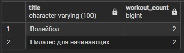


## 3. GROUPING SETS, ROLLUP и CUBE

### 3.1. GROUPING SETS - Подитоги по этажам и по залам отдельно
В одном запросе получить: (1) вместимость каждого зала, (2) подитог по каждому этажу, (3) общую вместимость всего клуба.
```sql
SELECT g.floor, g.name, SUM(g.capacity) AS total_capacity
FROM Gyms g
GROUP BY GROUPING SETS (
    (g.floor, g.name), 
    (g.floor), 
    ()
);
```

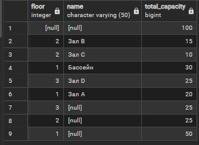

### 3.2. GROUPING SETS - Посещения по городам клиентов и по специализациям тренеров
Отдельно количество посещений по городам клиентов и по специализациям тренеров.
```sql
SELECT c.city, s.name AS specialization, COUNT(v.visit_id) AS visit_count
FROM Visits v
JOIN Clients c ON v.client_id = c.client_id
JOIN Workouts w ON v.workout_id = w.workout_id
JOIN WorkoutTypes wt ON w.workout_type_id = wt.workout_type_id
JOIN Trainers t ON wt.trainer_id = t.trainer_id
JOIN Specializations s ON t.spec_id = s.spec_id
GROUP BY GROUPING SETS (
    (c.city),
    (s.name)
);
```

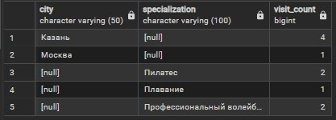

### 3.3. ROLLUP - Иерархия: этаж -> зал -> общий итог
Иерархический отчёт: сначала детализация по каждому залу, потом подитоги по этажам, потом общий итог по всему клубу.
```sql
SELECT g.floor, g.name, SUM(g.capacity) AS total_capacity
FROM Gyms g
GROUP BY ROLLUP (g.floor, g.name)
ORDER BY g.floor, g.name;
```

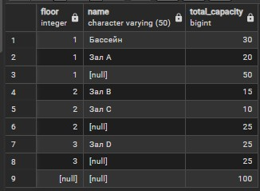

### 3.4. ROLLUP - Иерархия: город клиента -> количество посещений
Для каждого города клиента — количество посещений, а в конце — общий итог по всем городам.
```sql
SELECT c.city, COUNT(v.visit_id) AS visit_count
FROM Visits v
JOIN Clients c ON v.client_id = c.client_id
GROUP BY ROLLUP (c.city)
ORDER BY c.city;
```

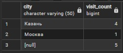

### 3.5. CUBE - Все комбинации: город клиента * специализация тренера
Количество посещений для каждой пары «город клиента + специализация тренера», а также все возможные подитоги (по городам, по специализациям и общий).
```sql
SELECT c.city, s.name AS specialization, COUNT(v.visit_id) AS visit_count
FROM Visits v
JOIN Clients c ON v.client_id = c.client_id
JOIN Workouts w ON v.workout_id = w.workout_id
JOIN WorkoutTypes wt ON w.workout_type_id = wt.workout_type_id
JOIN Trainers t ON wt.trainer_id = t.trainer_id
JOIN Specializations s ON t.spec_id = s.spec_id
GROUP BY CUBE (c.city, s.name)
ORDER BY c.city, s.name;
```

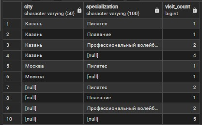

### 3.6. CUBE - Все комбинации: этаж * вместимость зала (анализ нагрузки)
Для каждого этажа и каждого зала - суммарную вместимость, а также все подитоги (по этажам, по залам, общий).
```sql
SELECT g.floor, g.name, SUM(g.capacity) AS total_capacity
FROM Gyms g
GROUP BY CUBE (g.floor, g.name)
ORDER BY g.floor, g.name;
```

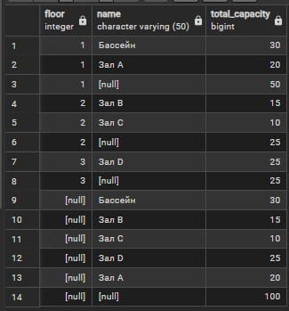


## 4. Полный запрос: SELECT, FROM, WHERE, GROUP BY, HAVING, ORDER BY

### 4.1. Города с высоким средним рейтингом посещений
Найти города, где клиенты в среднем ставят оценку 4.5 или выше, и отсортировать их по среднему рейтингу (от высшего к низшему).
```sql
SELECT c.city, 
       AVG(v.rating) AS avg_rating,
       COUNT(*) AS visit_count
FROM Visits v
JOIN Clients c ON v.client_id = c.client_id
WHERE v.rating >= 4
GROUP BY c.city
HAVING AVG(v.rating) >= 4.5
ORDER BY avg_rating DESC;
```

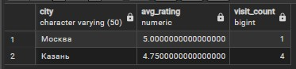

### 4.2. Популярные типы тренировок
Найти типы тренировок длительностью от 60 минут, которые проводились 2 или более раз. Вывести название типа, количество проведённых тренировок этого типа и их среднюю длительность. Отсортировать результат по количеству тренировок (по убыванию), а при равенстве — по средней длительности (по возрастанию).
```sql
SELECT wt.title,
       COUNT(w.workout_id) AS workout_count,
       AVG(wt.duration_min) AS avg_duration
FROM Workouts w
         JOIN WorkoutTypes wt ON w.workout_type_id = wt.workout_type_id
WHERE wt.duration_min >= 60
GROUP BY wt.title
HAVING COUNT(w.workout_id) >= 2
ORDER BY workout_count DESC, avg_duration ASC;
```

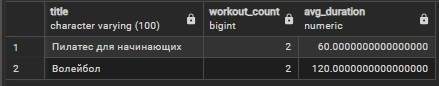
