## 1. Подзапрос в SELECT (Скалярный)

### 1.1. Список клиентов и общее количество посещений в клубе
Вывести имя и фамилию каждого клиента, а в соседнем столбце показать общее количество посещений (visits) во всем фитнес-клубе.

```sql
SELECT first_name, last_name, 
       (SELECT COUNT(*) FROM Visits) AS total_visits
FROM Clients;
```

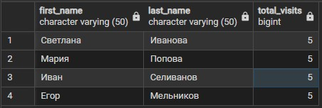

### 1.2. Типы тренировок и максимальная вместимость их залов
Для каждого типа тренировки вывести её название и максимальную вместимость зала, в котором она проводится.

```sql
SELECT title, 
       (SELECT MAX(capacity) FROM Gyms WHERE hall_id = wt.hall_id) AS max_hall_capacity
FROM WorkoutTypes wt;
```

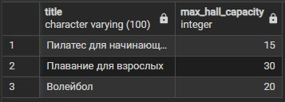

## 2. Подзапрос в FROM (Производная таблица)

### 2.1. Клиенты со средним рейтингом выше 4.5
Найти клиентов, чья средняя оценка за посещения строго больше 4.5.

```sql
SELECT client_id, avg_r 
FROM (
    SELECT client_id, AVG(rating) AS avg_r 
    FROM Visits 
    GROUP BY client_id
) AS sub
WHERE avg_r > 4.5;
```

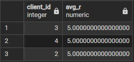

### 2.2. Количество тренировок в больших залах
Посчитать, сколько всего тренировок проводится в залах вместимостью более 20 человек.

```sql
SELECT COUNT(*) AS big_hall_workouts
FROM (
    SELECT w.workout_id 
    FROM Workouts w
    JOIN WorkoutTypes wt ON w.workout_type_id = wt.workout_type_id
    JOIN Gyms g ON wt.hall_id = g.hall_id
    WHERE g.capacity > 20
) AS sub;
```

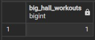

## 3. Подзапрос в WHERE

### 3.1. Клиенты, посещавшие длительные тренировки
Вывести данные клиентов, которые хотя бы раз посещали тренировку длительностью более 60 минут.

```sql
SELECT * FROM Clients 
WHERE client_id IN (
    SELECT v.client_id 
    FROM Visits v
    JOIN Workouts w ON v.workout_id = w.workout_id
    JOIN WorkoutTypes wt ON w.workout_type_id = wt.workout_type_id
    WHERE wt.duration_min > 60
);
```

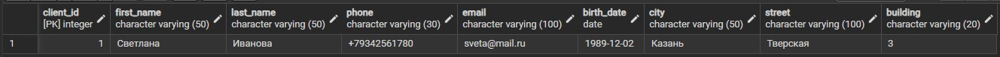

### 3.2. Тренеры, работающие в самом большом зале
Найти тренеров, которые проводят тренировки в зале с максимальной вместимостью.

```sql
SELECT * FROM Trainers 
WHERE trainer_id IN (
    SELECT trainer_id FROM WorkoutTypes 
    WHERE hall_id IN (
        SELECT hall_id FROM Gyms 
        WHERE capacity = (SELECT MAX(capacity) FROM Gyms)
    )
);
```

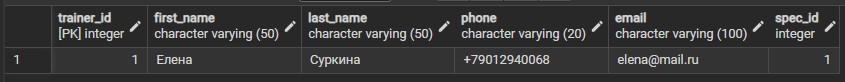

## 4. Подзапрос в HAVING

### 4.1. Города с рейтингом выше общего среднего
Найти города, где средний рейтинг посещений выше, чем средний рейтинг по всему клубу.

```sql
SELECT c.city, AVG(v.rating) AS city_avg
FROM Visits v
JOIN Clients c ON v.client_id = c.client_id
GROUP BY c.city
HAVING AVG(v.rating) > (SELECT AVG(rating) FROM Visits);
```

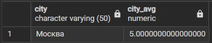

### 4.2. Этажи со средней вместимостью выше общей
Найти этажи, где средняя вместимость залов выше, чем средняя вместимость по всему клубу.

```sql
SELECT floor, AVG(capacity) AS floor_avg
FROM Gyms
GROUP BY floor
HAVING AVG(capacity) > (SELECT AVG(capacity) FROM Gyms);
```

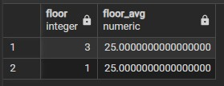

## 5. Оператор IN

### 5.1. Клиенты, посещавшие Пилатес
Вывести клиентов, которые ходили на "Пилатес для начинающих".

```sql
SELECT * FROM Clients 
WHERE client_id IN (
    SELECT v.client_id FROM Visits v
    JOIN Workouts w ON v.workout_id = w.workout_id
    JOIN WorkoutTypes wt ON w.workout_type_id = wt.workout_type_id
    WHERE wt.title = 'Пилатес для начинающих'
);
```

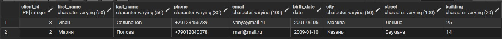

### 5.2. Клиенты, НЕ посещавшие Волейбол (NOT IN)
Вывести клиентов, которые ни разу не были на Волейболе.

```sql
SELECT * FROM Clients 
WHERE client_id NOT IN (
    SELECT v.client_id FROM Visits v
    JOIN Workouts w ON v.workout_id = w.workout_id
    JOIN WorkoutTypes wt ON w.workout_type_id = wt.workout_type_id
    WHERE wt.title = 'Волейбол'
);
```

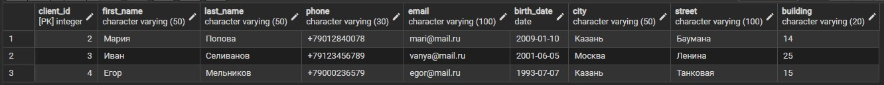

## 6. Оператор ANY

### 6.1. Клиенты с оценкой выше любой оценки Светланы
Найти посещения, где оценка строго больше ХОТЯ БЫ ОДНОЙ из оценок, поставленных клиентом 1 (Светланой).

```sql
SELECT * FROM Clients 
WHERE client_id IN (
    SELECT client_id FROM Visits 
    WHERE rating > ANY (SELECT rating FROM Visits WHERE client_id = 1)
);
```

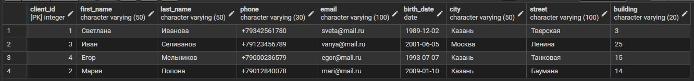

### 6.2. Тренировки короче любой тренировки в Зале А
Найти типы тренировок, длительность которых меньше ХОТЯ БЫ ОДНОЙ тренировки, проходящей в Зале А (hall_id = 1).

```sql
SELECT * FROM WorkoutTypes 
WHERE duration_min < ANY (
    SELECT wt.duration_min FROM WorkoutTypes wt 
    JOIN Workouts w ON wt.workout_type_id = w.workout_type_id 
    WHERE wt.hall_id = 1
);
```

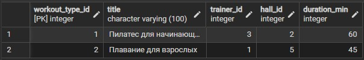

## 7. Оператор ALL

### 7.1. Тренировки длиннее всех тренировок на 2 этаже
Найти типы тренировок, длительность которых больше ВСЕХ тренировок, проходящих на 2 этаже.

```sql
SELECT * FROM WorkoutTypes 
WHERE duration_min > ALL (
    SELECT wt.duration_min FROM WorkoutTypes wt 
    JOIN Workouts w ON wt.workout_type_id = w.workout_type_id 
    JOIN Gyms g ON wt.hall_id = g.hall_id 
    WHERE g.floor = 2
);
```

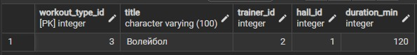

### 7.2. Клиенты, посещавшие клуб позже всех посещений Ивана
Найти клиентов, чьи даты посещений строго позже ВСЕХ дат посещений клиента 3 (Ивана).

```sql
SELECT * FROM Clients 
WHERE client_id IN (
    SELECT client_id FROM Visits 
    WHERE visit_date > ALL (SELECT visit_date FROM Visits WHERE client_id = 3)
);
```

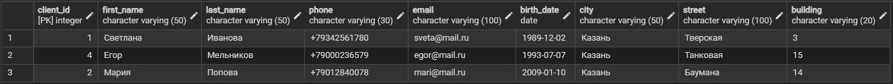

## 8. Оператор EXISTS

### 8.1. Клиенты, оставлявшие оценку 5
Вывести клиентов, которые существуют в таблице посещений с оценкой 5.

```sql
SELECT * FROM Clients c 
WHERE EXISTS (
    SELECT 1 FROM Visits v 
    WHERE v.client_id = c.client_id AND v.rating = 5
);
```

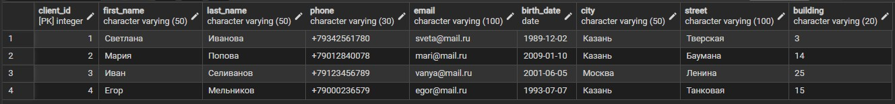

### 8.2. Тренеры без назначенных типов тренировок (NOT EXISTS)
Найти тренеров, для которых не создано ни одного типа тренировки.

```sql
SELECT * FROM Trainers t 
WHERE NOT EXISTS (
    SELECT 1 FROM WorkoutTypes wt WHERE wt.trainer_id = t.trainer_id
);
```

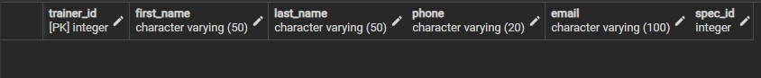

## 9. Сравнение по нескольким столбцам

### 9.1. Тренировки с той же парой (тренер, зал), что и у Пилатеса
Найти типы тренировок, которые проводит тот же тренер и в том же зале, что и "Пилатес для начинающих".

```sql
SELECT * FROM WorkoutTypes 
WHERE (trainer_id, hall_id) IN (
    SELECT trainer_id, hall_id FROM WorkoutTypes WHERE title = 'Пилатес для начинающих'
);
```

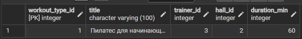

### 9.2. Посещения с той же парой (клиент, тренировка), что и у клиентов из Казани
Найти посещения, где пара (клиент, тренировка) совпадает с парами из таблицы Visits, но только для клиентов из Казани

```sql
SELECT * FROM Visits 
WHERE (client_id, workout_id) IN (
    SELECT v.client_id, v.workout_id 
    FROM Visits v
    JOIN Clients c ON v.client_id = c.client_id
    WHERE c.city = 'Казань'
);
```

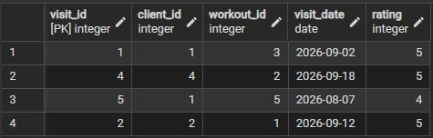

## 10. Коррелированные подзапросы

### 10.1. Количество посещений для каждого клиента
Вывести имя каждого клиента и сколько раз он посещал клуб.

```sql
SELECT first_name, last_name,
       (SELECT COUNT(*) FROM Visits v WHERE v.client_id = c.client_id) AS visit_count
FROM Clients c;
```

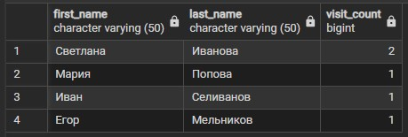

### 10.2. Количество тренировок для каждого типа
Вывести название типа тренировки и сколько раз она была запланирована в расписании.

```sql
SELECT title,
       (SELECT COUNT(*) FROM Workouts w WHERE w.workout_type_id = wt.workout_type_id) AS workout_count
FROM WorkoutTypes wt;
```

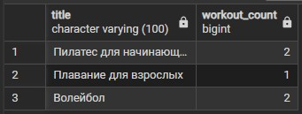

### 10.3. Количество типов тренировок в каждом зале
Вывести название зала и сколько разных типов тренировок в нем проводится.

```sql
SELECT name,
       (SELECT COUNT(*) FROM WorkoutTypes wt WHERE wt.hall_id = g.hall_id) AS type_count
FROM Gyms g;
```

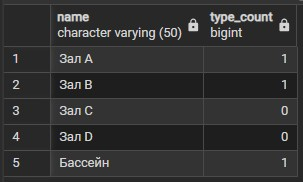


### 10.4. Клиенты со средним рейтингом выше 4.5 (через корреляцию)
Вывести имена клиентов, чей личный средний рейтинг строго больше 4.5.

```sql
SELECT first_name, last_name,
       (SELECT AVG(rating) FROM Visits v WHERE v.client_id = c.client_id) AS avg_rating
FROM Clients c
WHERE (SELECT AVG(rating) FROM Visits v WHERE v.client_id = c.client_id) > 4.5;
```

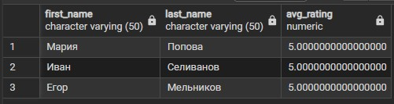


### 10.5. Дата последнего посещения для каждого клиента
Вывести имя клиента и дату его самого последнего визита.

```sql
SELECT first_name, last_name,
       (SELECT MAX(visit_date) FROM Visits v WHERE v.client_id = c.client_id) AS last_visit
FROM Clients c;
```

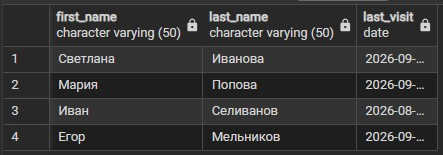