## 1. CTE 

### 1.1. Список клиентов из Казани и даты их посещений с оценками (используем обычный CTE для фильтрации клиентов).
```sql
WITH kazan_clients AS (
    SELECT client_id, first_name, last_name 
    FROM clients 
    WHERE city = 'Казань'
)
SELECT kc.first_name, kc.last_name, v.visit_date, v.rating
FROM kazan_clients kc
JOIN visits v ON kc.client_id = v.client_id
ORDER BY v.visit_date;
```

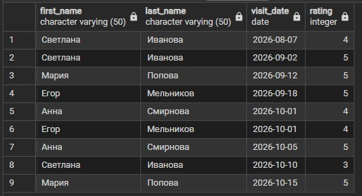

### 1.2. Найти все посещения с рейтингом выше среднего по базе, используя несколько CTE в одном запросе (первый CTE считает среднее, второй - фильтрует посещения по этому среднему).
```sql
WITH avg_rating AS (
    SELECT AVG(rating) AS avg_r 
    FROM visits
),
good_visits AS (
    SELECT v.visit_id, v.client_id, v.rating, wt.title
    FROM visits v
    JOIN workouts w ON v.workout_id = w.workout_id
    JOIN workouttypes wt ON w.workout_type_id = wt.workout_type_id
    WHERE v.rating > (SELECT avg_r FROM avg_rating)
)
SELECT * FROM good_visits ORDER BY rating DESC, visit_id;
```

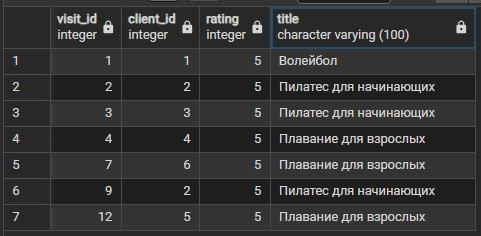

### 1.3. Построить иерархию тренеров: кто кому подчиняется (рекурсивный CTE). Начинаем с главного тренера (у которого нет руководителя) и спускаемся по уровням подчинения.
```sql
WITH RECURSIVE trainer_hierarchy AS (
    SELECT trainer_id, first_name, last_name, senior_trainer_id, 1 AS level
    FROM trainers
    WHERE senior_trainer_id IS NULL
    
    UNION ALL
    
    SELECT t.trainer_id, t.first_name, t.last_name, t.senior_trainer_id, th.level + 1
    FROM trainers t
    JOIN trainer_hierarchy th ON t.senior_trainer_id = th.trainer_id
)
SELECT * FROM trainer_hierarchy ORDER BY level, trainer_id;
```

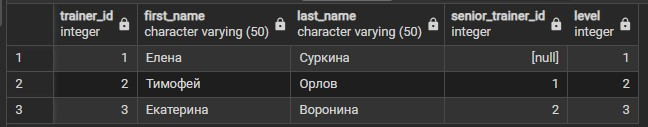


## 2. UNION

### Получить единый список всех людей, связанных с фитнес-клубом (клиентов и тренеров), с указанием их роли. Оператор UNION для объединения двух независимых выборок с одинаковой структурой столбцов.
```sql
SELECT first_name, last_name, 'Клиент' AS role 
FROM clients

UNION

SELECT first_name, last_name, 'Тренер' AS role 
FROM trainers

ORDER BY role, last_name;
```

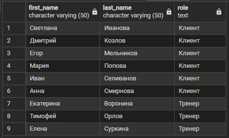


## 3. INTERSECT

### 3 Найти клиентов из Казани, которые хотя бы раз посещали тренировки. Оператор INTERSECT вернёт только те строки, которые присутствуют одновременно в обоих запросах.
```sql
SELECT client_id, first_name, last_name, city
FROM clients
WHERE city = 'Казань'

INTERSECT

SELECT c.client_id, c.first_name, c.last_name, c.city
FROM clients c
JOIN visits v ON c.client_id = v.client_id;
```

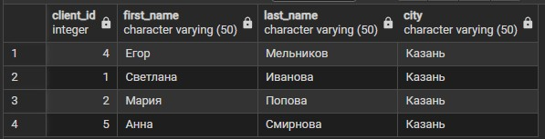


## 4. EXCEPT

### 4 Найти тренировки, которые никогда не посещались клиентами. Оператор EXCEPT вернёт строки из первого запроса, которых нет во втором запросе.
```sql
SELECT workout_id, start_time 
FROM workouts

EXCEPT

SELECT w.workout_id, w.start_time 
FROM workouts w 
JOIN visits v ON w.workout_id = v.workout_id;
```

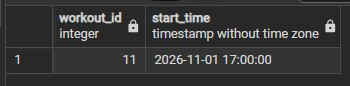


## 5. Оконные функции: PARTITION BY

### 5.1 Для каждого посещения показать средний рейтинг по типу тренировки, к которой оно относится. Здесь PARTITION BY делит все строки на группы по типу тренировки, но не сортирует их и не делает накопление - среднее считается по всей группе целиком и одинаково для всех строк внутри группы.
```sql
SELECT v.visit_id, wt.title, v.rating,
       ROUND(AVG(v.rating) OVER (PARTITION BY w.workout_type_id), 2) AS avg_rating_by_type
FROM visits v
JOIN workouts w ON v.workout_id = w.workout_id
JOIN workouttypes wt ON w.workout_type_id = wt.workout_type_id
ORDER BY wt.title, v.visit_id;
```

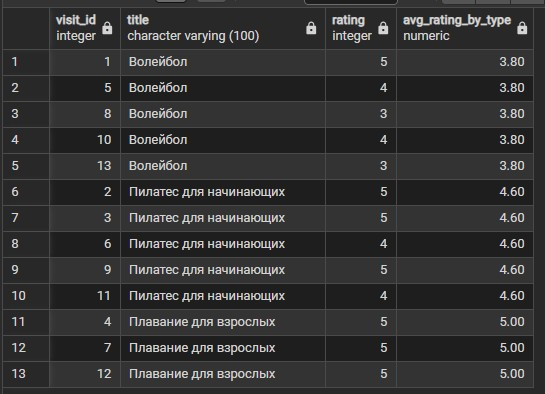

### 5.2 Посчитать общую сумму рейтингов для каждого клиента и вывести это число рядом с каждым его посещением. В отличие от GROUP BY, строки не сворачиваются, а к каждой строке добавляется вычисленное значение по всей партиции (группе).
```sql
SELECT client_id, visit_date, rating,
       SUM(rating) OVER (PARTITION BY client_id) AS total_rating_by_client
FROM visits
ORDER BY client_id, visit_date;
```

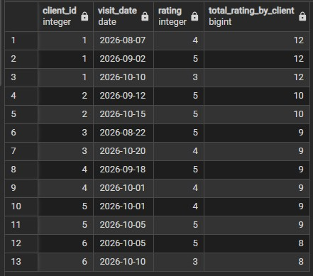


## 6. Оконные функции: PARTITION BY + ORDER BY

### 6.1 Накопление суммы рейтингов для каждого клиента по мере его посещений. При использовании ORDER BY внутри OVER() без явного указания ROWS/RANGE PostgreSQL автоматически применяет правило RANGE BETWEEN UNBOUNDED PRECEDING AND CURRENT ROW - то есть окно начинается с первой строки партиции и заканчивается текущей. Это даёт эффект накопления
```sql
SELECT client_id, visit_date, rating,
       SUM(rating) OVER (PARTITION BY client_id ORDER BY visit_date) AS cumulative_rating
FROM visits
ORDER BY client_id, visit_date;
```

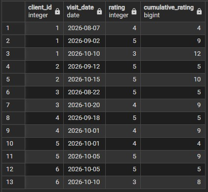

### 6.2 Посмотреть, как меняется средний рейтинг для каждого клиента по мере его посещений. Здесь используем AVG() с PARTITION BY и ORDER BY, что даёт эффект накопительного среднего.
```sql
SELECT client_id, visit_date, rating,
       ROUND(AVG(rating) OVER (PARTITION BY client_id ORDER BY visit_date), 2) AS avg_rating_so_far
FROM visits
ORDER BY client_id, visit_date;
```

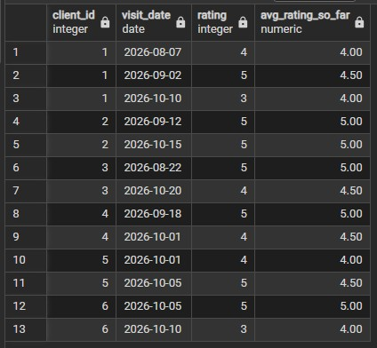


## 7. Оконные функции: ROWS

### 7.1 Посчитать сумму рейтингов за последние 2 посещения клиента (предыдущее + текущее). Явно задаем физические границы окна с помощью ROWS BETWEEN 1 PRECEDING AND CURRENT ROW.
```sql
SELECT client_id, visit_date, rating,
       SUM(rating) OVER (PARTITION BY client_id ORDER BY visit_date 
                         ROWS BETWEEN 1 PRECEDING AND CURRENT ROW) AS sum_last_2
FROM visits
ORDER BY client_id, visit_date;
```

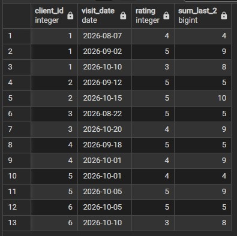

### 7.2 Посчитать скользящее среднее рейтинга за последние 3 посещения клиента (2 предыдущих + текущее). Явно задаем границы окна через ROWS BETWEEN 2 PRECEDING AND CURRENT ROW - это означает, что в окно всегда попадает максимум 3 строки.
```sql
SELECT client_id, visit_date, rating,
       ROUND(AVG(rating) OVER (PARTITION BY client_id ORDER BY visit_date 
                               ROWS BETWEEN 2 PRECEDING AND CURRENT ROW), 2) AS moving_avg_3
FROM visits
ORDER BY client_id, visit_date;
```

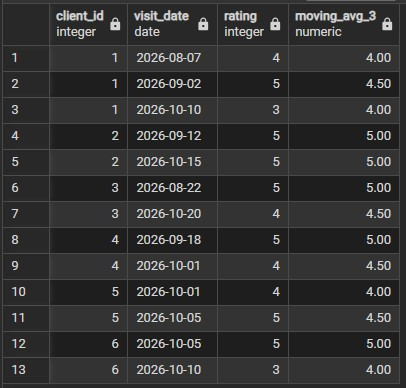


## 8. Оконные функции: RANGE

### 8.1 Посчитать накопительное количество посещений в зависимости от значения рейтинга. Здесь используем RANGE BETWEEN UNBOUNDED PRECEDING AND CURRENT ROW.
Главное отличие RANGE от ROWS: RANGE смотрит на значение столбца в ORDER BY. Если у нескольких строк одинаковое значение (например, несколько четвёрок), RANGE включит их в окно все сразу, а ROWS брал бы их по одной физической строке.
```sql
SELECT visit_id, rating,
       COUNT(*) OVER (ORDER BY rating 
                      RANGE BETWEEN UNBOUNDED PRECEDING AND CURRENT ROW) AS count_up_to_current_rating
FROM visits
ORDER BY rating, visit_id;
```

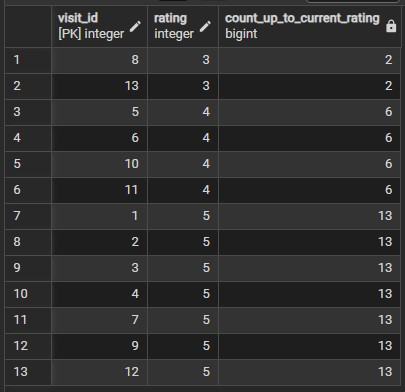

### 8.2 Посчитать накопительное среднее значение рейтинга для всех посещений, у которых рейтинг меньше или равен текущему.
Здесь мы снова используем RANGE BETWEEN UNBOUNDED PRECEDING AND CURRENT ROW. Ключевая фишка: UNBOUNDED PRECEDING означает "от самого начала партиции". Поскольку мы сортируем по rating, для всех строк с рейтингом 4 в окно попадут и все тройки, и все четвёрки.
```sql
SELECT visit_id, rating,
       ROUND(AVG(rating) OVER (ORDER BY rating 
                                RANGE BETWEEN UNBOUNDED PRECEDING AND CURRENT ROW), 2) AS avg_rating_up_to_current
FROM visits
ORDER BY rating, visit_id;
```

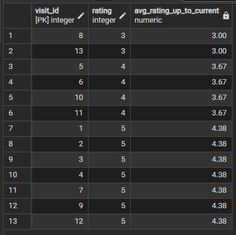


## 9 Ранжирующие: ROW_NUMBER

### 9 Пронумеровать посещения каждого клиента в хронологическом порядке. Функция ROW_NUMBER() присваивает уникальный порядковый номер каждой строке внутри своей партиции, начиная с 1. Даже если у двух посещений будут одинаковые дата и рейтинг, номера всё равно будут разными (1, 2, 3...).
```sql
SELECT client_id, visit_date, rating,
       ROW_NUMBER() OVER (PARTITION BY client_id ORDER BY visit_date) AS visit_number
FROM visits
ORDER BY client_id, visit_date;
```

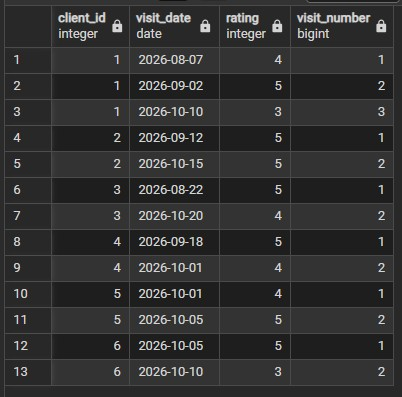

## 10 Ранжирующие: RANK

### 10 Ранжировать все посещения по рейтингу в порядке убывания (от лучших к худшим). Функция RANK() присваивает одинаковый ранг строкам с одинаковым значением, но делает пропуски в нумерации после группы одинаковых значений.
```sql
SELECT visit_id, client_id, rating,
       RANK() OVER (ORDER BY rating DESC) AS rating_rank
FROM visits
ORDER BY rating DESC, visit_id;
```

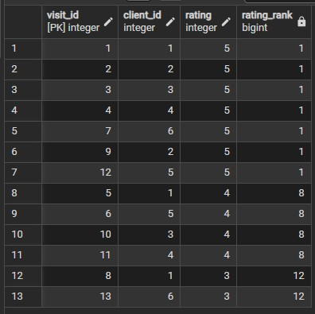

## 11. Ранжирующие: DENSE_RANK

### 11 Ранжировать все посещения по рейтингу в порядке убывания, но без пропусков в нумерации. Функция DENSE_RANK() работает так же, как RANK(), но после группы одинаковых значений следующий ранг увеличивается ровно на 1, а не на количество строк в группе.
```sql
SELECT visit_id, client_id, rating,
       DENSE_RANK() OVER (ORDER BY rating DESC) AS dense_rating_rank
FROM visits
ORDER BY rating DESC, visit_id;
```

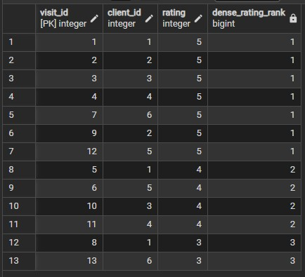


## 12. Функции смещения: LAG

### 12 Показать предыдущий рейтинг для каждого посещения клиента, чтобы можно было сравнить динамику оценок (например, стало лучше или хуже, чем в прошлый раз). Функция LAG позволяет "заглянуть" в предыдущую строку окна, не делая самоджойн таблицы.
```sql
SELECT client_id, visit_date, rating,
       LAG(rating, 1) OVER (PARTITION BY client_id ORDER BY visit_date) AS prev_rating
FROM visits
ORDER BY client_id, visit_date;
```

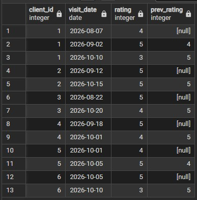

## 13. Функции смещения: LEAD

### 13 Показать следующий рейтинг для каждого посещения клиента, чтобы можно было посмотреть, как изменится оценка в будущем (прогнозирование динамики). Функция LEAD - это зеркальное отражение LAG: она "заглядывает" вперёд, а не назад.
```sql
SELECT client_id, visit_date, rating,
       LEAD(rating, 1) OVER (PARTITION BY client_id ORDER BY visit_date) AS next_rating
FROM visits
ORDER BY client_id, visit_date;
```

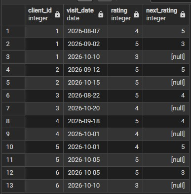

## 14. Функции смещения: FIRST_VALUE

### 14. Показать первый (самый ранний) рейтинг каждого клиента и сравнить его с текущим рейтингом. Функция FIRST_VALUE возвращает значение из самой первой строки окна.
```sql
SELECT client_id, visit_date, rating,
       FIRST_VALUE(rating) OVER (PARTITION BY client_id ORDER BY visit_date) AS first_rating
FROM visits
ORDER BY client_id, visit_date;
```

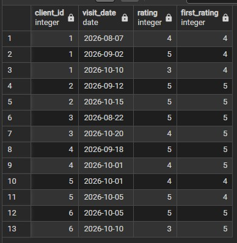

## 15. Функции смещения: LAST_VALUE

### 15. Показать последний (самый свежий) рейтинг каждого клиента рядом с каждым его посещением.
```sql
SELECT client_id, visit_date, rating,
       LAST_VALUE(rating) OVER (PARTITION BY client_id ORDER BY visit_date 
                                ROWS BETWEEN UNBOUNDED PRECEDING AND UNBOUNDED FOLLOWING) AS last_rating
FROM visits
ORDER BY client_id, visit_date;
```

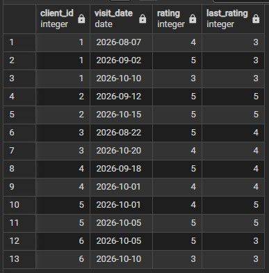